# Personalized HLA-aware TCR measure predicts the risk of symptomatic SARS-CoV-2 infection following booster vaccination

## Code

### 1. Query repertoires against the HLA-aware spike atlas

Querying repertoires against the HLA-aware spike atlas requires the Python
repository `/spike_atlas/v1_catalog_breadth.py`.

### 2. Generate analysis data and include HLA-aware breadth estimates

After completing the query, the long- and wide-form analysis data and estimates
of HLA-aware spike-reactive breadth (HA-Ts) are generated from the spike_atlas
hits files using `001_COV_BOOST_ADATA.R`.

### 3. Analysis and Visualization

Code for analysis and visualization presented per result figure in this repository.

## Version 1 Figures

### Fig 1. v1_Fig_1.png

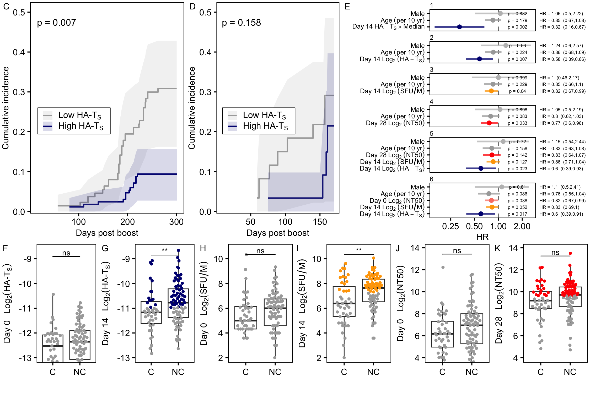

### Fig 2. v1_Fig_2.png

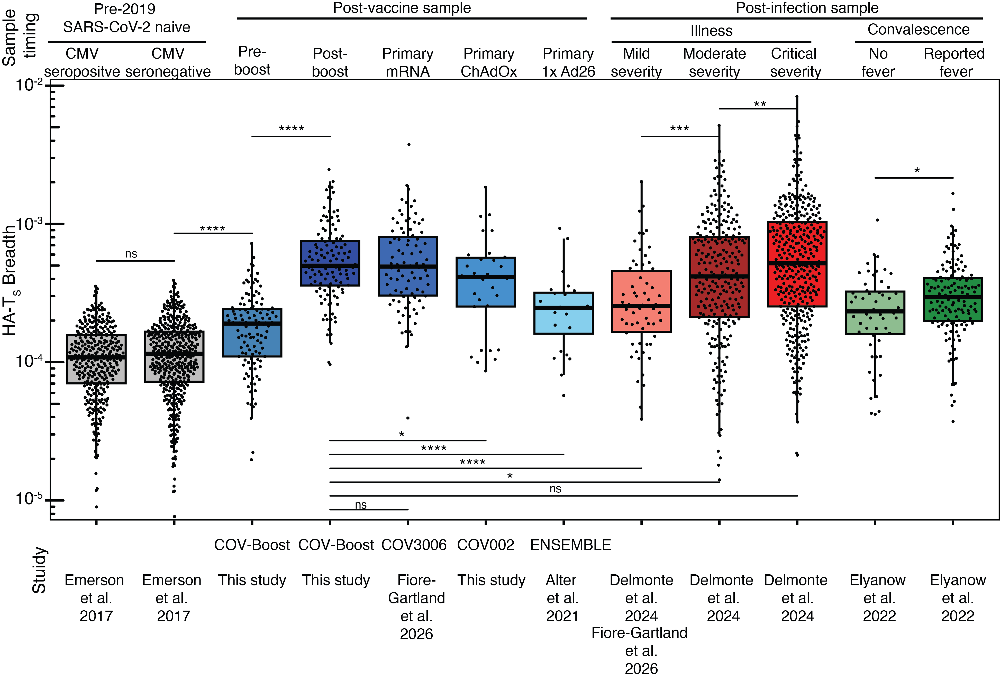

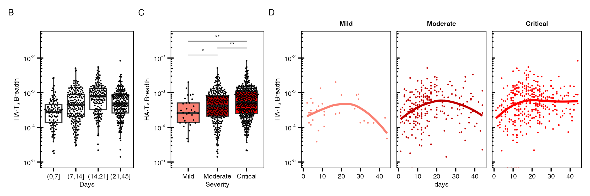

### Fig 3. v1_Fig_3.png

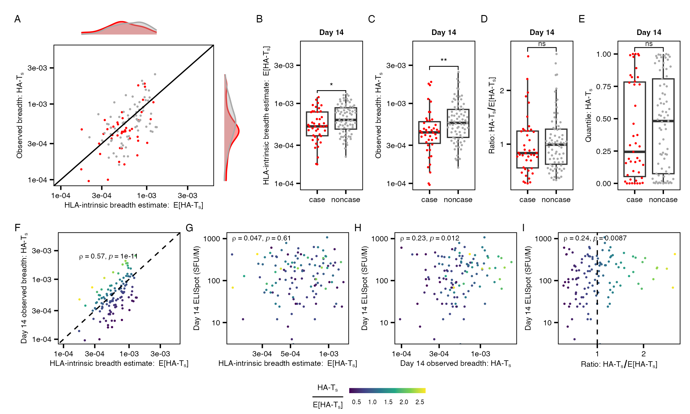

### Fig 4. v1_Fig_4.png

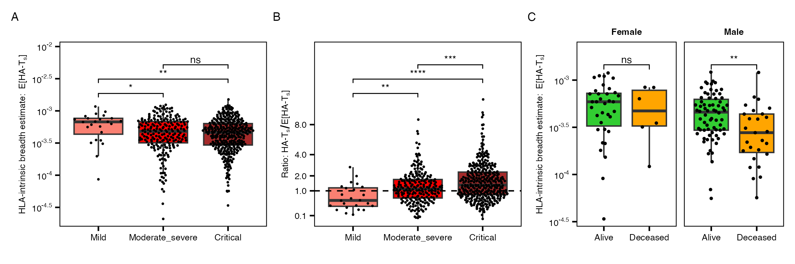

## Version 1 Extended Data Figures

### Extended Data Fig. 1

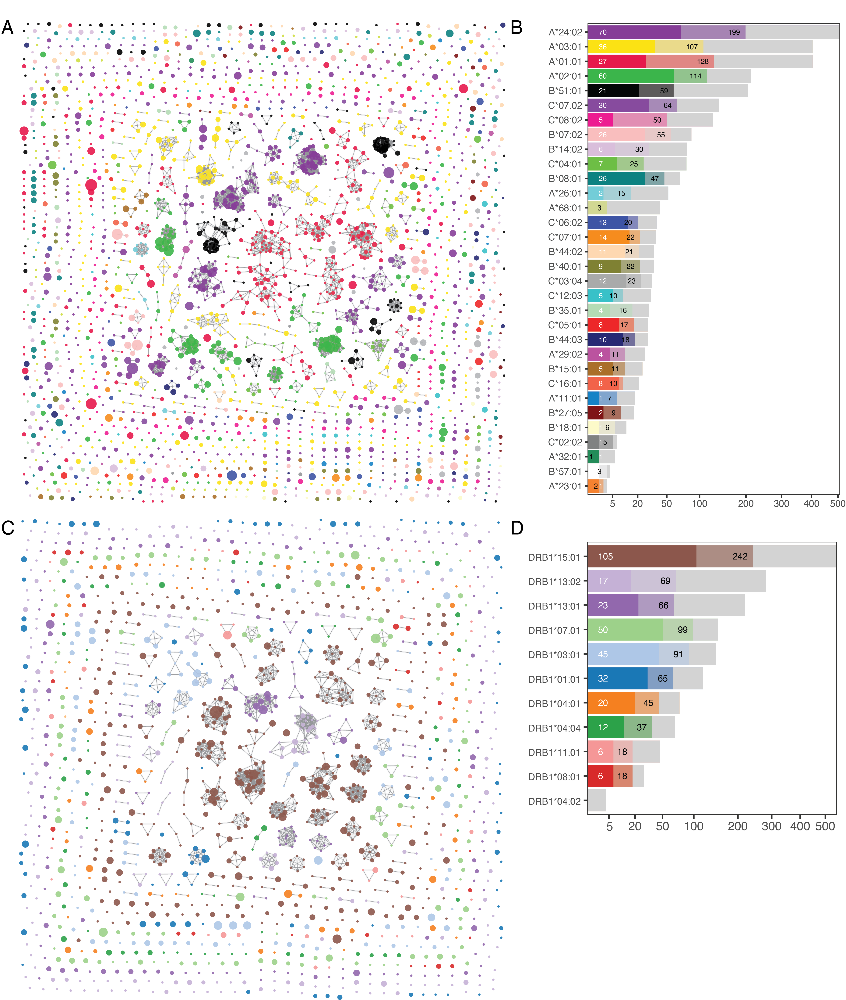

### Extended Data Fig. 2

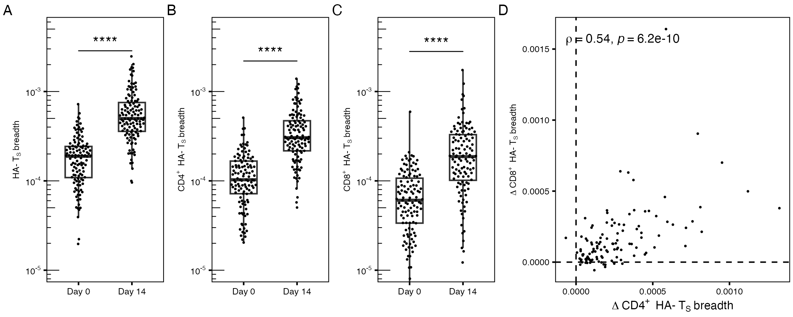

### Extended Data Fig. 3

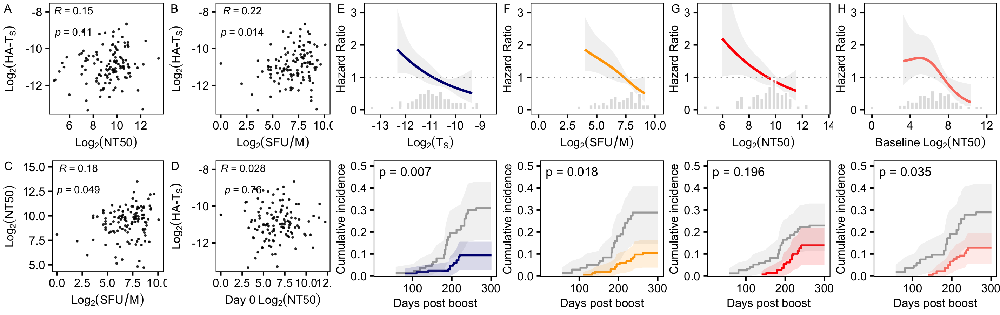

### Extended Data Fig. 4

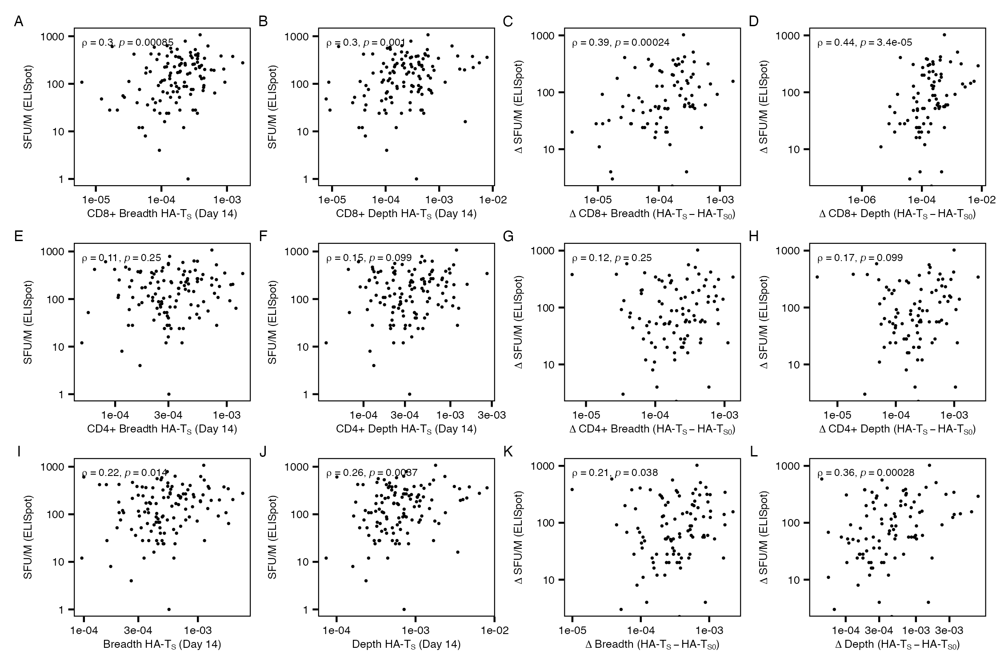

### Extended Data Fig. 5

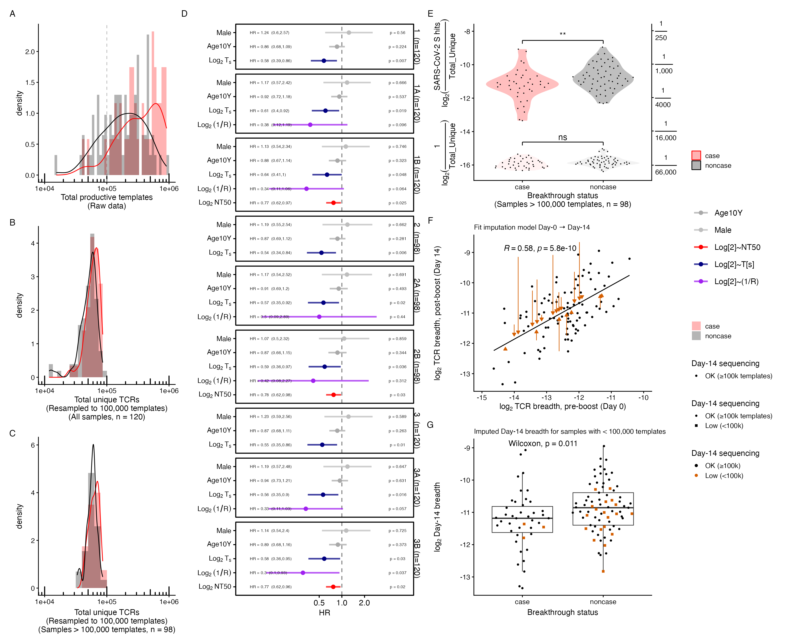

### Extended Data Fig. 6

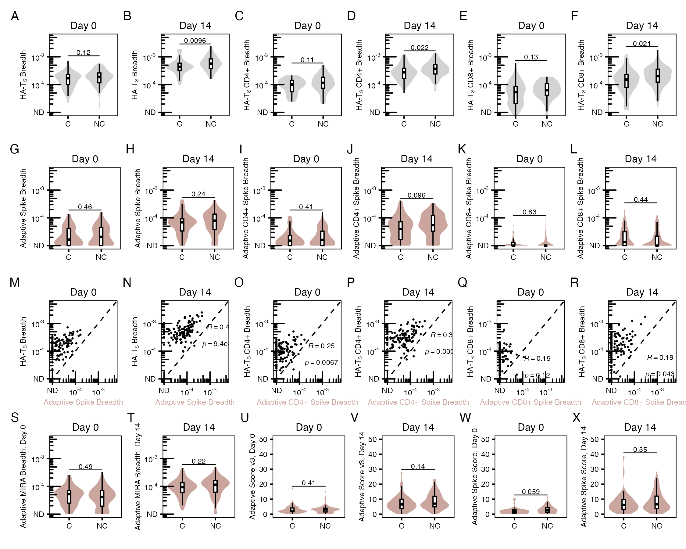

### Extended Data Fig. 7

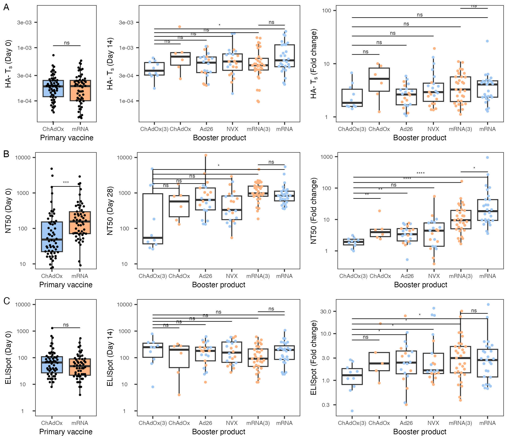

### Extended Data Fig. 8

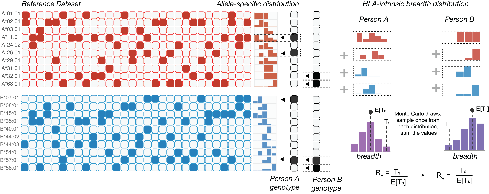

### Extended Data Fig. 9

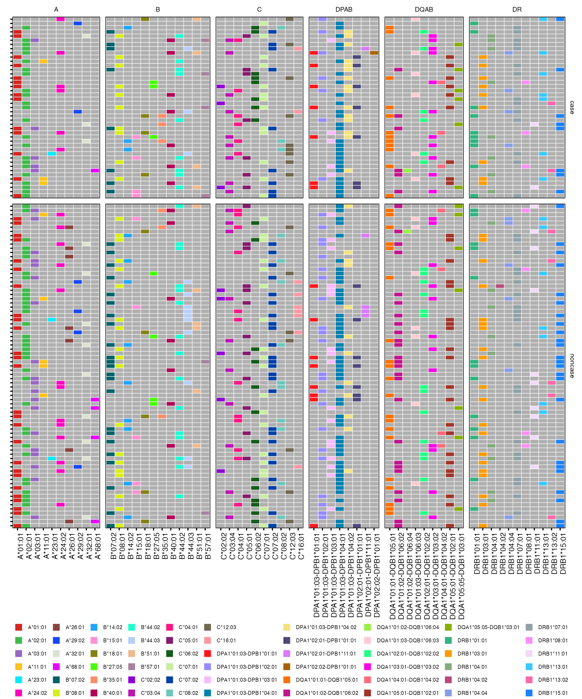
